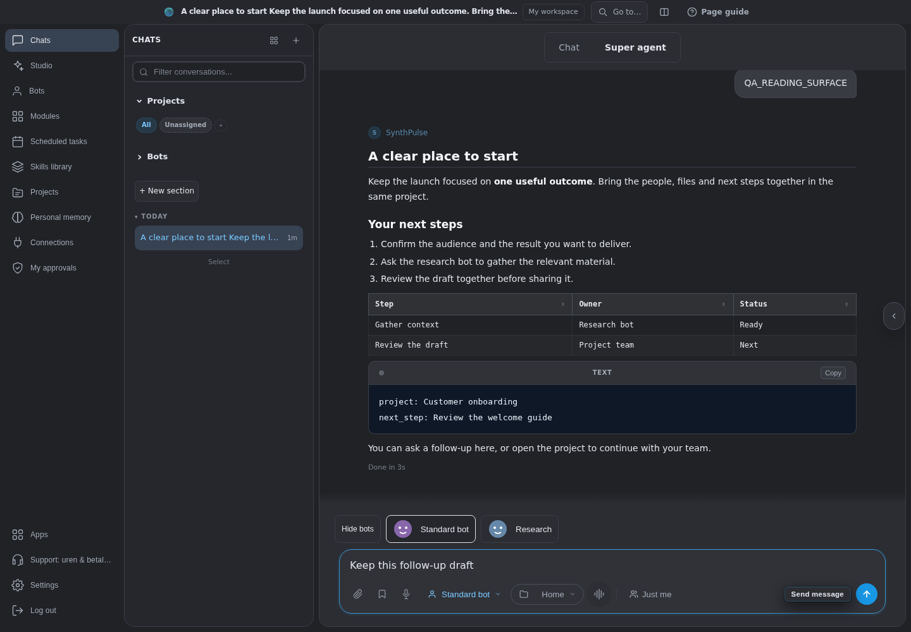
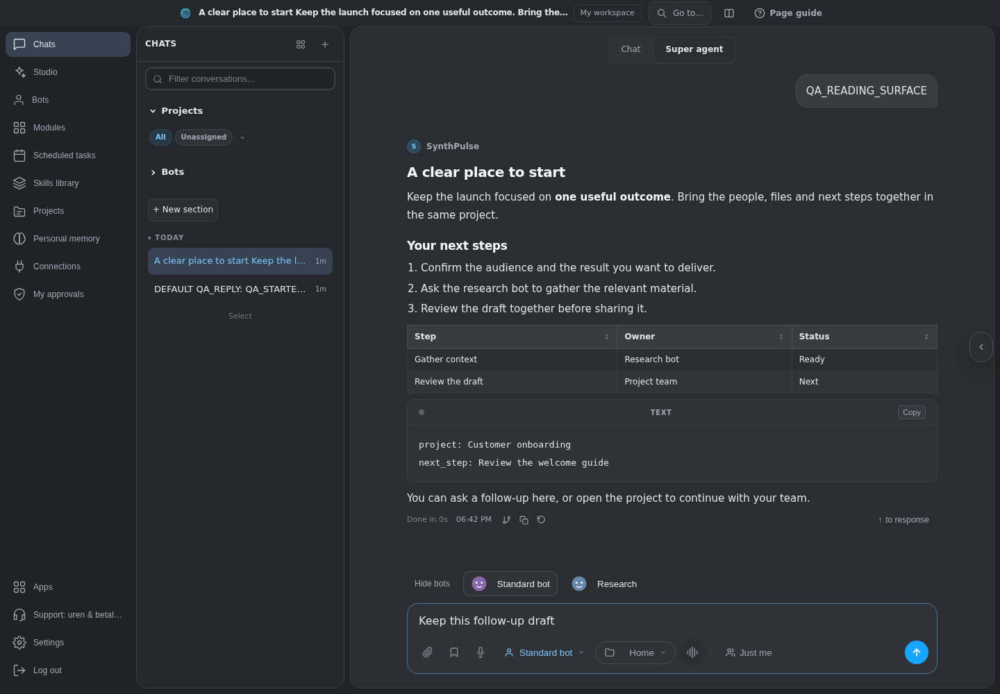

# Chat workspace visual and behavior review

This slice applies the content hierarchy from [Herm's design system](https://github.com/chryzxc/herm/blob/49153ef322bd08953f85e122de5def3cc50db1c8/DESIGN.md): one dominant work area, a coherent welcome/composer group, quiet secondary controls and readable answers. It uses the existing SynthPulse DOM and handlers, without Herm assets, Swift code or a new dependency.

- On roomy desktops, the welcome and mounted composer sit together. Phones and short windows keep the composer at the bottom. Existing welcome/suggestion preferences remain effective.
- Starter buttons append a localized question to the existing draft and focus the input. Repeating the same last starter does not duplicate it. The normal input handler owns persistence, resize and Send state. Only an explicit Send starts a turn.
- Prose, composer and bot roster share a content width. Neutral code surfaces, proportional table text and quieter headings support the reading hierarchy. The default skin uses 15px body text; explicit text-size choices still apply.
- The bot roster uses smaller avatars and quieter selection styling; its disclosure label follows locale changes through the existing i18n mechanism.
- Assistant identity text no longer compounds a 60% opacity with a muted color. Existing message actions remain accessible at rest and with keyboard focus.

State boundaries: only the existing textarea draft is changed by starters. The transcript renderer remains the owner of empty/live visibility; CSS reacts to its existing DOM. No new session, runtime, approval or permission state is introduced. Projects remains the unified destination and standalone Spaces/Kanban navigation remains absent.

## Verification

Real Chromium, backend and engine, synthetic signed-in accounts and a deterministic loopback provider. The reading sample is generated by that test provider and persisted through the normal chat path.

- Before the change, the starter regression failed because clicking a suggestion replaced the draft, sent immediately and left an empty input.
- The final focused run passed all five cases: three chat-workspace cases, the existing searchable bot switcher and persisted-draft reload. The starter case was strengthened and rerun for Dutch draft persistence and live roster-label translation.
- Earlier neighboring checks passed for Stop during startup, Stop during generation and both bot-editor/search flows.
- 20 focused Python checks passed. One locale-source assertion also fails on the base checkout: it expects 15 inline locale definitions in i18n.js although catalogs now live in separate files.
- The supplemental manual-denial browser case cannot observe its expected pending approval, including on the previous PR commit c12df1b61 with unchanged product sources. Approval styling and behavior are outside the final change. This flow is not certified by this review.
- Runtime lint, JavaScript syntax and diff checks passed.
- Measured text contrast: at least 5.25:1 light / 5.48:1 dark for welcome copy, starters, composer placeholder and roster disclosure; at least 5.25:1 light / 5.89:1 dark for answer text, table cells and bot identity. Measurements use computed colors, ancestor opacity and composited backgrounds after transitions settle.

Reviewed desktop (1440px), narrow (900px), phone (390px), a 390×500 short viewport, light/dark, welcome hidden, suggestions hidden, larger text and reduced motion. This is browser visual QA, not a native mobile keyboard/device test or full-suite certification. No production deployment was performed.

## Visual evidence

The before/after reading views use the same synthetic answer and member role.

| Previous reading surface | Current reading surface |
| --- | --- |
|  |  |

[Welcome in Dutch](welcome-dutch.png) · [Light reading surface](reading-light.png) · [Phone reading surface](reading-mobile.png) · [Narrow welcome](welcome-narrow.png) · [Phone welcome](welcome-mobile.png)

Machine-readable outcomes and contrast readings: [verification.json](verification.json).
