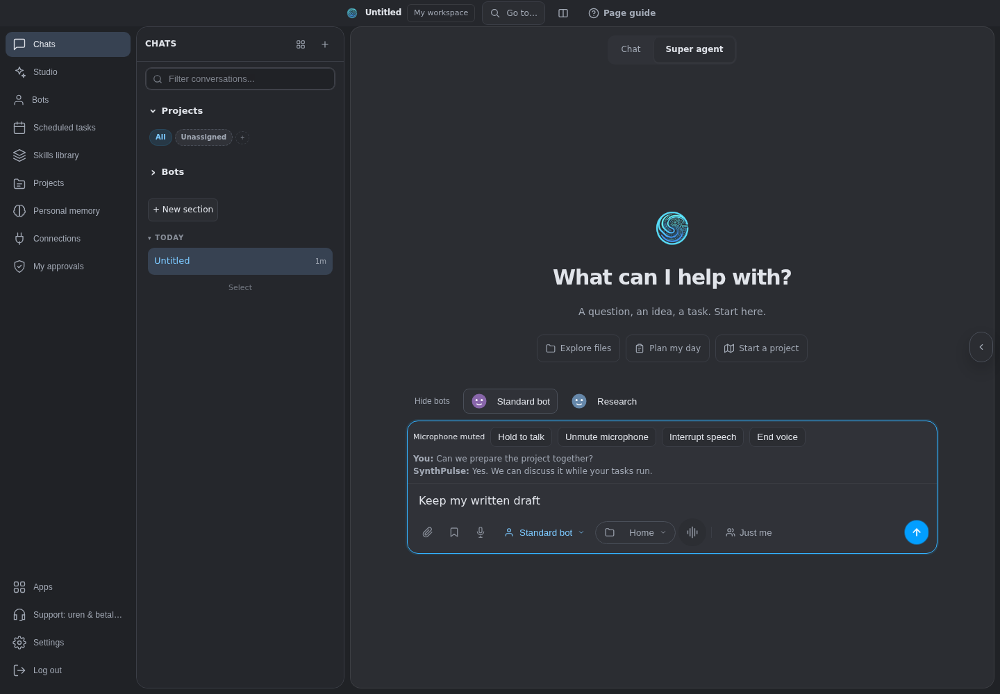
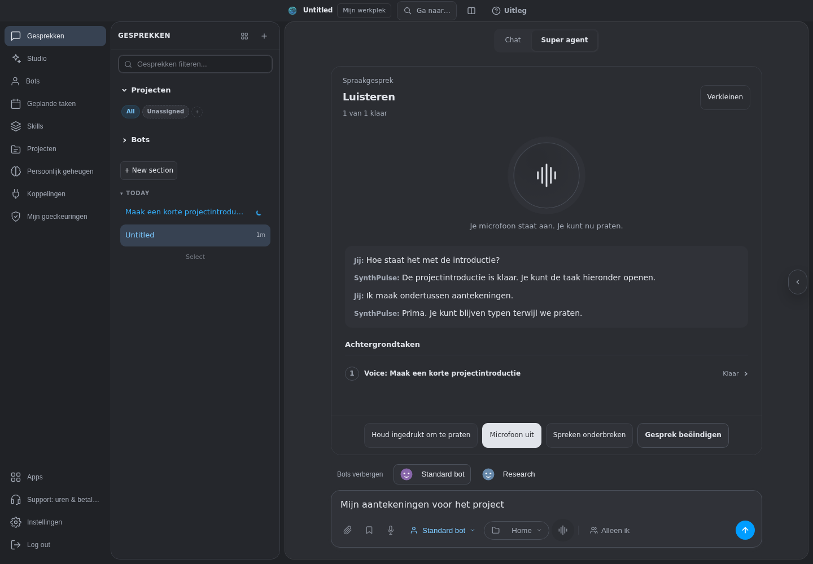
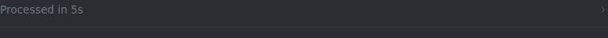
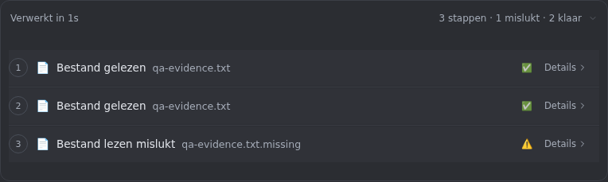

# Voice and work steps QA

Presentation inspired by Herm's voice stage and execution timeline. The changes
read the existing realtime controller and canonical activity scene. They do not
add a runtime, event subscription, microphone owner or permission bypass.

## Behavioral evidence

- Both new browser cases failed before implementation: the voice view control
  and per-turn step summary did not exist. Before images use commit 9ed94385e.
- The voice case passes with continuous microphone state and draft preservation
  across minimize/expand, Dutch locale changes, a real background child job,
  desktop/900px/390px layouts, short viewport, reduced motion and end/focus return.
- Existing native two-turn speech, background file execution, end-with-work-
  running, microphone/PTT/interruption/session-change, microphone refusal and
  remote-end cases passed against the new pane. Browser audio and WebRTC are
  synthetic; authenticated HTTP, sideband, engine and child sessions are real.
- The step case executes three actual reads, including a missing file. It checks
  two successful outcomes and one failure, numbering, keyboard details, lazy
  history after reload, one disclosure for all actions and responsive layouts.
- The neighboring tool-status case passes for successful reads of error-looking
  content. Its stale “Updated a file” assertion was updated to the already-
  existing “Edited a file” label without relaxing outcome checks.
- The capability-race case passes after matching api()'s existing in-flight GET
  coalescing. Canceling both launch intents before the shared result arrives
  creates no peer or microphone track. The old test expected two network reads
  and fails identically before these changes.
- 50 of 51 selected Python checks pass, covering the voice controller, lazy
  history, mobile worklogs and scene persistence. One scene-hydration assertion
  expects an unmatched running tool to become completed; it also fails on the
  prior checkout. The new summary explicitly reports such completion as
  unconfirmed instead of deriving success from the end of the turn.
- Runtime lint, JavaScript syntax and whitespace checks pass.

The final focused browser run and a follow-up step-layout check are recorded in
verification.json. Counts across runs overlap; they are not a full-suite total.

## Visual review

Inspected actual Chromium screenshots in both themes and at 1440, 900 and 390px.
Voice text/control samples measure at least 5.25:1 in light mode and 5.89:1 in
dark mode, including opacity. Reduced-motion disables the voice presence pulse.
Short 390×500 viewport controls remain reachable. Real mobile keyboard resizing
and physical microphone/audio quality were not tested.

| Before | After |
| --- | --- |
|  |  |
|  |  |

[Light voice](voice-light.png) · [Narrow voice](voice-narrow.png) ·
[Mobile voice](voice-mobile.png) · [Mobile steps](steps-mobile.png)

## Governance follow-up

The initial approval fixture expected every ordinary tool call to prompt for
approval. The current policy instead reviews **access requests** and treats a
configured mandatory CLI command as a separate human decision. Later browser
tests exercise that actual boundary: the voice pane stays open, the exact child
request is approved once or denied, and the file effect is checked. An ordinary
permitted file operation does not prompt. The unmatched historical tool case
now verifies its running/unconfirmed status instead of inventing a result.

Browser audio, provider events and calls use synthetic fixtures. These runs do
not measure a physical microphone, speaker quality or a live provider call.
