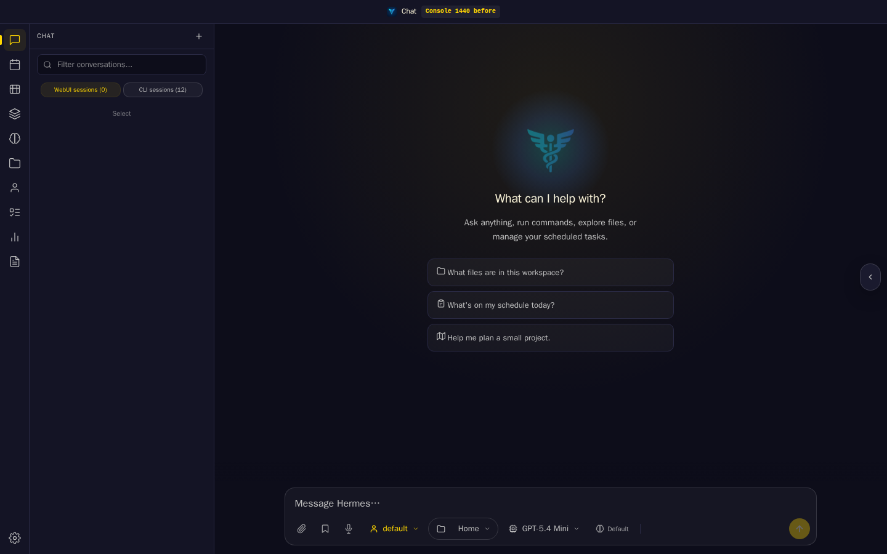
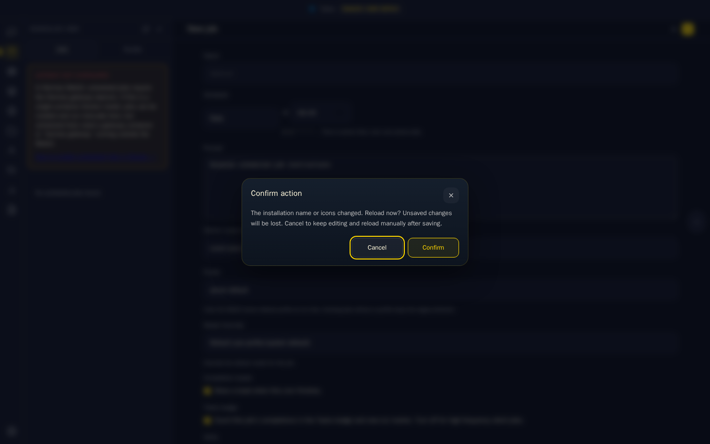
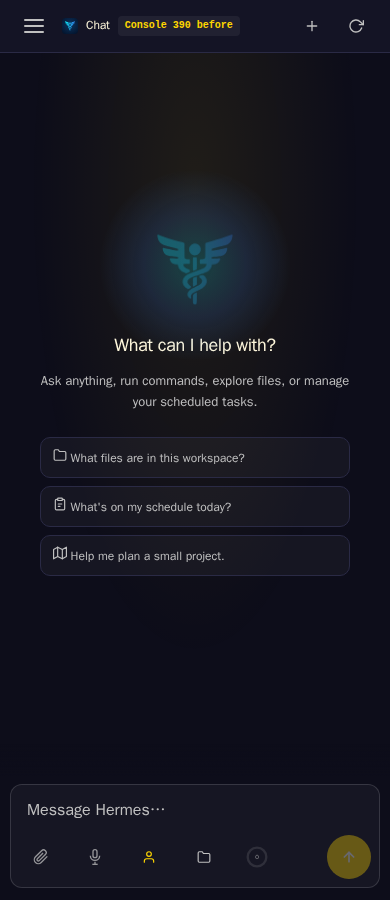
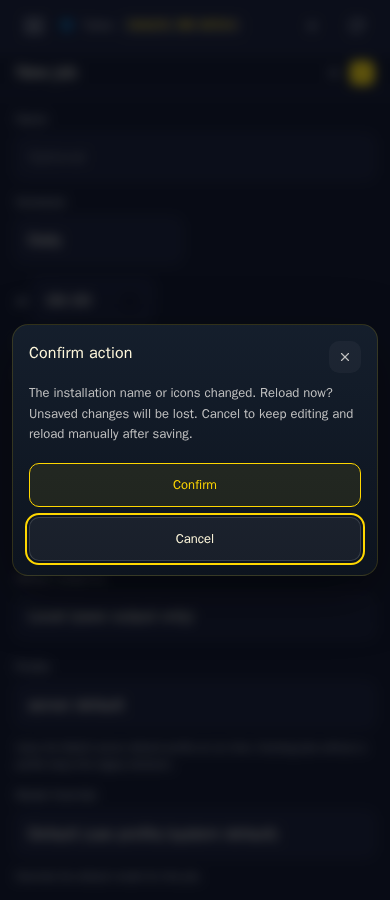

# Returning-tab branding review

Captured on 10 November 2026 in Chromium 158.0.8127.18 at 1440 × 900
and 390 × 900 (touch/mobile emulation). These are real WebUI shell and
scheduled-job editor views on an isolated localhost server, with disposable
owner sessions, a generic compatible-provider fixture and generated icons.
No real service, user data or production installation was changed.

| Width | Before: automatic reload loses the editor | After: ask before reloading |
| --- | --- | --- |
| Desktop |  |  |
| Narrow |  |  |

The before run serves only `static/instance-branding.js` from `036339c5`;
the rest of the shell is the same. Each run opens the real scheduled-job
form and types `Unsaved scheduled-job instructions`. A second authenticated
request changes the installation name, then the page's visibility event is
dispatched. Before the fix, navigation removes the unsaved form. After the
fix, the shared app dialog asks for confirmation and focuses Cancel.

Assertions verify that Cancel retains the exact prompt text, repeated returns
with the declined revision do not reopen the dialog, and accepting a later
revision reloads into the updated title. No page JavaScript errors occurred.
`test_real_cron_editor_survives_branding_change` automates the real-page Cancel
path at both widths; the Node regression also covers explicit acceptance,
unchanged revisions, an existing dialog, hidden tabs and offline recovery.

The capture driver awaits the production refresh callback between simulated
events; the initial fixture skips onboarding and selects English. External
CDN requests are blocked, service workers are disabled and HTTP responses are
not browser-cached while routing. The optional provider is a protocol fixture,
not the separately packaged extension editor. These images and assertions prove
page behavior; they do not certify native tab-switch event delivery, a physical
phone, OS notifications, installed PWA updates or service-worker/cache behavior.
